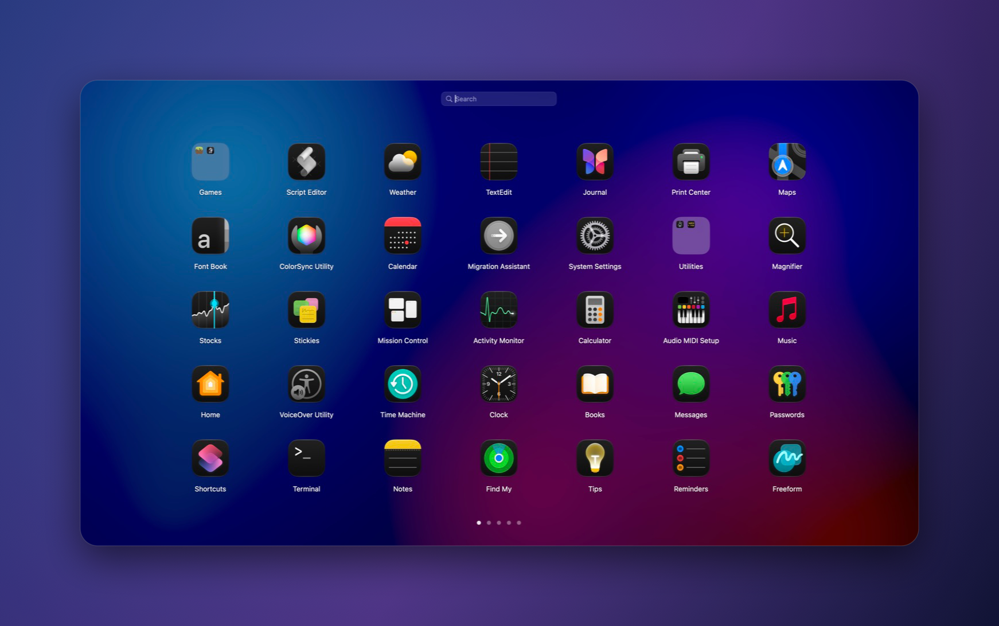
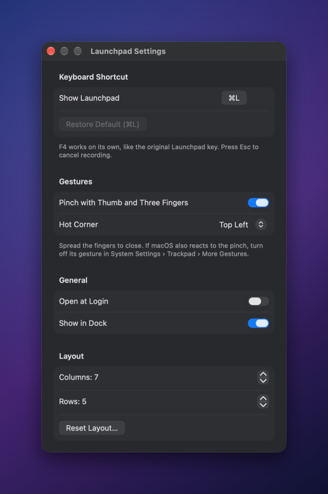

# Launchpad_Back — the classic Launchpad for macOS Tahoe (26)

> Bring back Launchpad on macOS 26 Tahoe: the full-screen app grid with pages, folders and drag-to-arrange, free and open source.

**[English](./README.md) | [繁體中文](./README_zh-TW.md) | [简体中文](./README_zh-CN.md)**

<div align="center">
  <a href="https://github.com/EricYang801/Launchpad_Back/releases/latest">
    
  </a>
  <br /><br />
  <strong><a href="https://github.com/EricYang801/Launchpad_Back/releases/latest">⬇ Download the latest release</a></strong>
  <br /><br />
  
</div>

## Why

Apple removed Launchpad in macOS 26 Tahoe and replaced it with the "Apps" view in Spotlight. If you miss the familiar full-screen grid of app icons — swiping between pages, grouping apps into folders, arranging everything by hand — Launchpad_Back brings it back. It is a native SwiftUI + AppKit app, free and open source under GPL-3.0.

## Features

- **Full-screen, like the original** — covers the whole screen on the display with the mouse pointer, over your blurred and dimmed desktop wallpaper (falls back to a system blur material), with a zoom-and-fade open/close animation.
- **Paged icon grid** — 7 columns × 5 rows by default, just like the original Launchpad. Adjust columns (4–12) and rows (3–9) in Settings. Clickable page dots at the bottom.
- **Natural paging** — two-finger trackpad swipes follow your fingers and snap into place; the mouse wheel turns one page per notch; click-and-drag on empty space to swipe; arrow keys work too.
- **Folders in the Big Sur style** — translucent tiles preview 9 apps. Drop an app onto another to create a folder; it is auto-named after the App Store category (e.g. "Developer Tools", "Games") and opens so you can rename it. Click the folder title to rename, drag apps out to remove them. A folder left with one app turns back into that app. Folders with more than 15 apps get pages.
- **Edit mode** — long-press an icon or simply start dragging. Icons jiggle and move aside live while you drag; hold a dragged icon at the screen edge to move it to another page. Click empty space or press `Esc` to finish.
- **Type to search** — just start typing. Matches localized app names, English names, bundle IDs and paths, with name-prefix matches first. Arrow keys move the selection, `Return` opens it.
- **Global shortcut** — default `⌘L`, re-recordable in Settings. `F1`–`F20` can be used on their own, so `F4` works like the old Launchpad key.
- **Trackpad pinch** — pinch your thumb and three fingers together to open Launchpad, spread them to close it, just like the original gesture. Only exactly four fingers count; five-finger pinches are left to macOS (see [the FAQ](#the-pinch-also-opens-macoss-apps-view-or-shows-the-desktop)).
- **Hot corner** — move the pointer into a screen corner of your choice to show or hide Launchpad.
- **Drag to the Dock** — the Dock stays visible above Launchpad, as in the original; drag an app onto it to keep it there.
- **Finds all your apps** — `/System/Applications` (incl. Utilities), `/Applications` and its subfolders (e.g. Adobe suites), `~/Applications`, and Homebrew Caskroom on Apple silicon (`/opt/homebrew`) and Intel (`/usr/local`). Rescans every time Launchpad opens, so new or removed apps show up immediately.
- **Your layout is kept** — order and folders are saved locally. Apps that are temporarily missing (e.g. on an unplugged drive) keep their place and come back to it. Layouts from 2.x are migrated automatically.
- **Light on memory** — about 40 MB of RAM with ~150 apps installed. Icons are rasterized at the size they are shown, search results are computed once per query, and a rescan that finds no changes skips the redraw.
- **Localized** — English, Traditional Chinese and Simplified Chinese.

## Install

1. Download `Launchpad_Back.app.zip` from the **[latest release](https://github.com/EricYang801/Launchpad_Back/releases/latest)**.
2. Unzip it.
3. Move `Launchpad_Back.app` into `/Applications`.
4. Open it, then press `⌘L` (or click its Dock icon) to show Launchpad.

### Requirements

- macOS 15.6 or later (works on macOS 26 Tahoe)
- Apple silicon or Intel Mac

### First launch

The app is ad-hoc signed, not notarized, so macOS blocks it the first time. Either:

- Right-click (or Control-click) `Launchpad_Back.app` → **Open**, then confirm; or
- Try to open it once, then go to **System Settings → Privacy & Security** and click **Open Anyway**.

You only need to do this once.

## Usage

| Action | How |
| --- | --- |
| Show / hide Launchpad | Global shortcut (default `⌘L`), pinch with thumb and three fingers (spread to close), the hot corner, click the Dock icon, or open the app again |
| Open an app | Click its icon |
| Turn pages | Two-finger swipe, mouse wheel, click-and-drag on empty space, `←` / `→`, or click a page dot |
| Search | Start typing; `↑` `↓` `←` `→` move the selection, `Return` opens it |
| Enter edit mode | Long-press an icon, or just start dragging one |
| Move an app to another page | Drag it and hold it at the left or right screen edge |
| Create a folder | Drop an app onto another app |
| Rename a folder | Click the folder title |
| Remove an app from a folder | Drag it out of the open folder |
| Add an app to the Dock | Drag it onto the Dock |
| Go back one step | `Esc`: cancel drag → close folder → leave edit mode → clear search → close Launchpad |
| Close Launchpad | Launch an app, click empty space, switch to another app, or `⌘W` |
| Open Settings | `⌘,` |
| Quit | `⌘Q` |

## Settings

Press `⌘,` while Launchpad is open.



- **Shortcut** — click the button and press a new combination. Regular keys need `⌘`, `⌥` or `⌃`; `F1`–`F20` can be used alone.
- **Pinch with Thumb and Three Fingers** — on by default.
- **Hot Corner** — off by default; pick Top Left, Top Right, Bottom Left or Bottom Right.
- **Open at Login** — start Launchpad_Back automatically when you log in.
- **Show in Dock** — turn off to hide the Dock icon.
- **Grid** — columns (4–12) and rows (3–9).
- **Reset Layout** — clear your custom order and folders.

## FAQ

### Where did Launchpad go in macOS Tahoe?

Apple removed Launchpad in macOS 26 Tahoe. Its replacement is the "Apps" view inside Spotlight, which lists apps but has no free-form pages or folders you arrange yourself.

### How do I get Launchpad back on macOS 26?

Install Launchpad_Back from the [latest release](https://github.com/EricYang801/Launchpad_Back/releases/latest), allow it on first launch (see [First launch](#first-launch)), and press `⌘L`. Turn on **Open at Login** in Settings so it is always available.

### Can I use F4 like the old Launchpad key?

Yes. Open Settings (`⌘,`), click the shortcut button and press `F4`. Function keys `F1`–`F20` can be used without modifiers. On many Mac keyboards you may need to hold `fn`, or enable "Use F1, F2, etc. keys as standard function keys" in System Settings → Keyboard.

### Does it keep my folders?

Your order and folders are saved locally and survive restarts and updates. Layouts created with Launchpad_Back 2.x are migrated automatically. It does not import the layout from Apple's old Launchpad.

### The pinch also opens macOS's "Apps" view or shows the desktop

macOS uses the same thumb-and-three-finger pinch for its own **Apps** view (spreading shows the desktop). Launchpad_Back only reacts to exactly four fingers, so turn off the system's four-finger pinch and keep the five-finger one for macOS. If the switch in **System Settings → Trackpad → More Gestures** doesn't stay off, run this in Terminal:

```bash
defaults write com.apple.AppleMultitouchTrackpad TrackpadFourFingerPinchGesture -int 0
defaults write com.apple.driver.AppleBluetoothMultitouch.trackpad TrackpadFourFingerPinchGesture -int 0
killall Dock
```

Then log out and back in. Check it with `defaults read com.apple.AppleMultitouchTrackpad TrackpadFourFingerPinchGesture` (`0` is off). To undo, run the same commands with `-int 2`.

### Does it need any permissions?

No. The global shortcut uses Carbon hot keys, the hot corner only watches pointer movement, and the pinch reads trackpad touches locally, so no Accessibility permission is needed. Everything stays on your Mac.

### Is this an Apple app?

No. Launchpad_Back is an independent open-source project and is not affiliated with or endorsed by Apple. "Launchpad" and "macOS" are trademarks of Apple Inc.

## Build from source

Requires Xcode 26.

```bash
git clone https://github.com/EricYang801/Launchpad_Back.git
cd Launchpad_Back
open Launchpad_Back.xcodeproj   # then press ⌘R
```

Or from Terminal:

```bash
xcodebuild build -scheme Launchpad_Back -destination 'platform=macOS'
```

Run the unit tests:

```bash
xcodebuild test -scheme Launchpad_Back -destination 'platform=macOS' -only-testing:Launchpad_BackTests
```

## Contributing

Bug reports, ideas and pull requests are welcome — please [open an issue](https://github.com/EricYang801/Launchpad_Back/issues) first for larger changes.

```text
Launchpad_Back/
├── App/        app delegate, window controller, input handling, global hot key
├── Model/      store, layout, grid metrics, preferences
├── Services/   app scanner, icon cache, wallpaper
├── Views/      SwiftUI views
└── Localizable.xcstrings   English, Traditional Chinese, Simplified Chinese strings
```

## License

[GPL-3.0](./LICENSE) © [EricYang801](https://github.com/EricYang801)

Launchpad_Back is not affiliated with Apple Inc.
